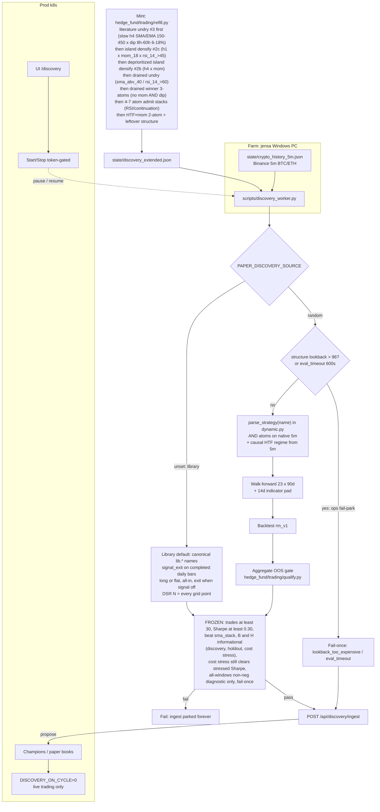
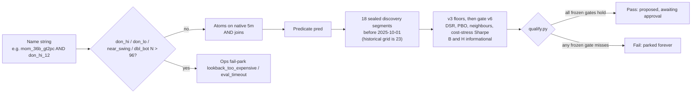
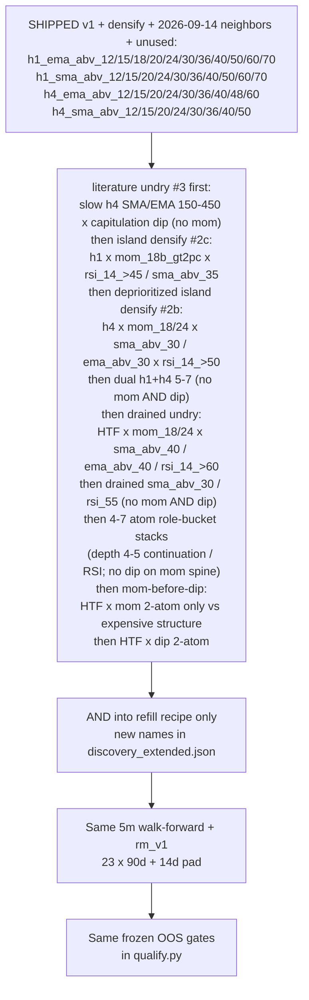

# Discovery and live workflow

**Paper only.** No real-money broker. OOS **thresholds** are frozen; these
diagrams do not change them.

Maintenance: update these diagrams in the same PR that changes mint/farm/eval/prod topology (refill recipe shape, window count, ingest, farm location, gate meaning).

This is the canonical map of how a name is minted, walked on jensa, gated,
ingested, and traded on the cluster. Read it on GitHub — the Mermaid
blocks render there. PROTOCOL amendments remain the honesty contract;
this file is the living topology.

## Legend

| Piece | Where | What it does |
|---|---|---|
| **Library** | `hedge_fund/library/catalog.py` | Default discovery source since gate v6 (2026-10-28; warmed 2026-10-29). A claim leases only the canonical variant of each pre-registered daily strategy (`lib.<key>`), in catalog order. No random mint, no lift, no refill, no buy-and-hold retest. `scripts/requeue_library_gate.py` (dry-run unless `--apply`) can put a canonical name back on that queue when its newest discovery-log row is an older gate tag than `gate_v7b_library_profit_20261029`, including a name that is already seated. The retest appends one log row and does not change the champion row or the paper account. A pass stays proposed. The one-at-a-time grid is scored inside that evaluation for neighbours and PBO and is not a search. DSR trial count is every grid point of the catalog (149 after the 2026-10-30 batch; 64 when the catalog was the original 15). Indicators use BTC history from 2017-08-17; a day that is not warm is refused. A 20% stop fills at the next open and is not a second trial. `scripts/run_library.py` evaluates the library locally. |
| **Mint** | `hedge_fund/trading/refill.py` on the farm | **Off by default.** Runs only when `PAPER_DISCOVERY_SOURCE=random`. Bounded DIP/MOM + structure AND recipe (`STRUCTURE_NS` through **96** — no `don_hi` / `don_lo` / `near_swing_*` / `dbl_bot` `N>96`), plus densified HTF buyer-regime ANDs (`h1_ema_abv_{12,15,18,20,24,30,36,40,50,60,70}` / `h1_sma_abv_{12,15,20,24,30,36,40,50,60,70}` / `h4_ema_abv_{12,15,20,24,30,36,40,48,60}` / `h4_sma_abv_{12,15,20,24,30,36,40,50}`). **Island densify #2c first** (`rsi_14_>45`, `sma_abv_35` on h1 × `mom_18b_gt2pc`). Deprioritized island densify #2b: h4 twins of the paying `h1_* & mom_18b_gt2pc & *_abv_30 & rsi_14_>50` shape (`ISLAND2B_H4` × `mom_18b_gt2pc`/`mom_24b_gt2pc` × `sma_abv_30`/`ema_abv_30` × `rsi_14_>50`, sparse 3-atoms, dual h1+h4 and h1-only 5–7). Not another `*_abv_40` / `rsi_>60` lead. Then drained **fresh never-tested families**: admit-island densify (`sma_abv_40` / `ema_abv_40`, `rsi_14_>60`, `MOM_FILTERS_HTF_INTERMEDIATE` on paid-off `h1_*_abv_{20,24,30,50,60}` spines, `h1_sma_abv_70`) then drained unused HTF/mom (`REGIME_ATOMS_FRESH` / `MOM_FILTERS_HTF_FRESH`) and winner-shaped stacks (REGIME+MOM × `sma_abv_30` / `ema_abv_30` × rsi, plus `rsi_14_>55`). Then drained admit-island **3-atoms first**: `regime&mom&sma_abv_50` / `ema_abv_20` (not HTF×mom×structure; recipe no longer ANDs `mom_gt` with `mild_dip`). Then **4–7 atom role-bucket** stacks on that island are continuation / RSI only (depth 4–5; REGIME+MOM spine, 0–2 continuation, 0–1 RSI; never a dip on that spine; DEEP includes `h1_ema_abv_60` / `h1_sma_abv_50` / `h1_sma_abv_60`). Cheap `near_swing_hi` N≤48 only at depth 7 was dip-gated and is not minted. Then HTF×mom 2-atom (`regime&mom`, including `MOM_FILTERS_HTF_DENSE` / `MOM_FILTERS_HTF_EXPAND` / `MOM_FILTERS_HTF_FRESH`) — 2-atom only vs expensive structure — then HTF×dip 2-atom only. Mom-before-dip: `mom_18b_gt2pc` first among regime mom bases, `dip_24b_lt5pc` / `dip_24b_lt6pc` / `dip_18b_lt2pc` first among regime dip bases (`REGIME_DIP_PRIORITY`). Central guard (`name_has_mom_gt_and_dip`) drops any `mom_*_gt*` ∧ `dip_*` stack. When never-tested leftovers run dry, the next handful is appended to `state/discovery_extended.json`. Static `generate_universe()` stays inside the ~40–120 compiled-list band. |
| **Farm** | Linux laptop and Windows `jensa` | `scripts/discovery_worker.py` evaluates names against local `state/crypto_history_5m.json` (Binance 5m, **BTC/USDT and ETH/USDT only**). Discovery qualification and new live entries are BTC/USDT only; ETH/USDT is the soft cross-asset check and stays on the tape so an existing ETH lot can still hit its stop. Default: `POST /api/discovery/claim` leases names on prod (several hosts, no shared cursor). In library mode (the default) those names are the canonical library strategies, scored with `signal_exit` on completed daily bars from that tape. `--local-plan` is the old local plan and, in library mode, also returns only those names. `PAPER_DISCOVERY_SOURCE=random` keeps the 5m `rm_v1` path. Before that walk-forward: structure lookback cap (`DISCOVERY_STRUCTURE_LOOKBACK_MAX` = 96) fail-parks `lookback_too_expensive`; 600s per-name eval timeout is a backstop only. The worker keeps one eval in flight per core, posts each result as it finishes, and reuses the process pool and loaded tape until the tape hash changes. Ops/throughput, not a gate softening. When the claimable pool is empty, random mode refills from the recipe; library mode does not. Mint, densify, lift and refill run inside a holdout seal and cannot read bars from 2025-10-01 onward. In library mode the worker also downloads warmed BTC daily bars (`GET /api/discovery/library/daily`, same ingest token) and does not claim `lib.*` names when that series is missing or still starts after 2017-08-17. |
| **Eval** | library `signal_exit`, or (random mode) lookback guard → `parse_strategy` → walk-forward → backtest → gate | **Default:** canonical `lib.*` name → the downloaded BTC daily series (2017-08-17, not the canonical 5m cut) → the catalog signal (no lookahead; an unwarmed day fails rather than counting as flat) → `signal_exit` (long or flat, all-in, exit when the signal turns off, next-open fill, 20% stop at the next open) → gate v7b vetoes (OOS and holdout net P&L > 0 after fees, the same on both spans at 2× fees + 5 bps, ≥8 out-of-sample round-trips, ≥2 holdout trades). DSR (N = every library grid point), PBO, Sharpe, neighbours, sma_stack, and buy-and-hold are warnings. **Random mode only** (`PAPER_DISCOVERY_SOURCE=random`): name string → structure lookback cap → AND atoms on native 5m → 18 sealed discovery segments (the first of the 23-segment grid, each ending before 2025-10-01) → `rm_v1` paper backtest on BTC/USDT → v3 aggregate in `hedge_fund/trading/qualify.py` → the 5m floors (30 trades, 8 holdout trades, Sharpe, sma_stack, DSR, PBO, neighbours, cost-stress Sharpe; buy-and-hold informational; ETH Sharpe recorded and does not block). |
| **Ingest** | `POST /api/discovery/ingest` | Token-gated. Pass → proposed, awaiting approval. It is not seated. Seating is `force_admit` or `promote_candidates`, and that path does not refuse because of how many champions are active. Fail → parked forever (fail-once), except one admin-queued v4 discovery-window buy-and-hold retest and one admin-queued library gate-tag retest (`scripts/requeue_library_gate.py`). A library retest of a seated name appends the log row and leaves the champion and the paper account as they are. Ingest never culls existing champions. A separate one-shot, `lib-sma100-forward-test-20261029`, seats `lib.sma100` as an unproven paper forward test (`qualified=false`) from the library tape and does not rewrite the discovery log. Batch `lib-rsi2-sma200-v7-20261029` seats `lib.rsi2` and `lib.sma200` once from a qualified verdict under the current gate tag and records warnings and `approved_by`. |
| **Prod** | k8s cycle sidecar | `DISCOVERY_ON_CYCLE=0` — live trading only (`run_isolated` → collect → report). Klines are the persistent BTC/ETH 5m tape at `state/live_tape/*.npy` (qualification span, incremental append), not a 300-bar tail. Each cycle publishes `library_daily_BTC_USDT.npz` (BTC days from 2017-08-17) for the web to send; the web process does not resample that file per request. A fresh `lib.*` book whose signal is already long waits for the next 00:00 UTC open window before it buys. `GET /api/status` and `/api/summary` include `live_history` (bars and last bar time per symbol). Do not turn discovery back on in-cluster. UI: `/discovery`. |
| **Farm Start/Stop** | `/discovery` → `POST /api/discovery/farm` | Same ingest token. Worker **idles** (does not exit). Start cannot relaunch a dead process. |
| **Champion pool ops** | `POST /api/champions/retain` and `POST /api/champions/cull_undated` | Same ingest token. Explicit paper-ops exception: drop names from `champions.json` so `live_cycle` stops them. Does not delete trade DBs. `cull_undated` keeps only non-empty `champion_since`. |
| **Retire** | `hedge_fund.trading.retire` (one-shot batch at server start) | Moves names that failed a named requalify batch from `champions.json` / `graduated.json`, and orphan live accounts with no pool record (batch `orphan-live-20261008`), to `retired.json` (archive, not delete). Retired names never re-admit or re-mint. `GET /api/champions/retired`. |

**Current walk-forward (full jensa 5m tape):**
`QUAL_N_WINDOWS` = 23, `QUAL_WINDOW_DAYS` = 90, `QUAL_COVERAGE_DAYS` = 2070
(~5.67y of native 5m; 23 × 90). Per-window size stays 90d (honest hold-outs,
not one giant in-sample). Each window is prefixed with `QUAL_WARMUP_BARS` =
4032 (~14d of 5m) so EMA/SMA/HTF/ATR are warm when scored bars begin.
OOS trades/PnL/Sharpe exclude the pad (and train). First window uses a
partial prefix if the file is short. Existing discovery_log admits were
under 8 × 90d (~720d) — no automatic re-qualify. Parked 8-window and
3-window evals stay parked (fail-once). Ingest requalify needs stored
`regimes_tested` = 23. jensa `crypto_history_5m.json` already covers this
span (~600787 bars).

**FROZEN OOS gates** (do not edit here to "make names pass"):

- OOS trades ≥ 30
- average OOS Sharpe ≥ 0.30
- beat `sma_stack` on those windows
- buy-and-hold is informational on the discovery windows, the sealed holdout, and the cost-stress re-run (gate v5, 2026-10-27; still true under gate v6). Cost stress still requires stressed Sharpe ≥ 0.30
- gate v6 daily library (2026-10-29): 8 out-of-sample round-trips, 2 holdout trades, Sharpe ≥ 0.30, beat `sma_stack`, holdout Sharpe ≥ 0.30, DSR ≥ 0.95 with N = 64, PBO ≤ 0.20 on ~390-day blocks, ≥ 70% of neighbours, cost-stress Sharpe ≥ 0.30. The 5m floors in the list above stay 30 and 8. A daily rule that fails only on a trade count is still a fail (`count_only` on the row)
- all-windows non-negative is a **diagnostic only** (not a veto)
- fail-once: a non-qualify parks that name forever

**Gate v4 (2026-10-27), on top of those floors.** Discovery scores `DISCOVERY_N_WINDOWS` = 18 (87d segments that end on or before 2025-10-01). `QUAL_N_WINDOWS` = 23 stays the historical full-tape grid and is not what mint reads. The holdout `[2025-10-01, 2026-10-01)` is scored once after a v3 pass and is never written back onto the Sharpe or P&L mint reads. Bars after 2026-10-01 are forward/live only. Extra floors, all config constants: deflated Sharpe probability ≥ 0.95 using the tested-candidate count, CSCV PBO ≤ 0.20 on the candidate plus its parameter neighbours, ≥ 70% of those neighbours still at Sharpe ≥ 0.30 and ≥ 30 trades, and a 2× fee + 5 bps/side re-run that still has Sharpe ≥ 0.30 and beats buy-and-hold. ETH/USDT Sharpe > 0 over the same windows is recorded and does not block. A qualified ingest row without that block is rejected. Forward-test criteria are stored at admission and only flag (live Sharpe < 0 or live max drawdown > 1.5× the backtest max drawdown, after both 90 days and 20 closed trades). Nothing is auto-retired.

**Gate v5 (2026-10-27). No qualification check requires beating buy-and-hold.** Historical tag `V5_GATE_RULES` = `gate_v5_btc_holdout_dsr_pbo_20261027`. A loss to buy-and-hold, or a missing buy-and-hold daily Sharpe, is not a fail on the discovery windows, the sealed holdout, or the cost-stress re-run. Those figures stay on the row. The holdout still requires Sharpe, the holdout trade floor, and beat `sma_stack`. Cost stress still requires stressed Sharpe ≥ 0.30. Paper graduation after 80 closed trades is net paper P&L > 0 after taker fee and slippage; buy-and-hold P&L is an informational column. There is no champion cap (2026-10-28; the gate v5 forward cap of 5 is deleted). `GET /api/champions` ranks every qualified name that is not already active, graduated, or retired (DSR, then daily Sharpe, then lower PBO) and marks each one `proposed, awaiting approval`. That list does not admit or retire. A newly qualified ingest is not seated. `force_admit` and `promote_candidates` are the explicit seats and do not refuse a sixth, or a fiftieth, active champion. Names already on the book are not retired. The 20-name arena stays deleted.

**Gate v6 (historical, warmed 2026-10-29).** `V6_WARMUP_GATE_RULES` = `gate_v6_library_warmup_20261029`.

**Gate v7 (historical, 2026-10-29, Alexander 10:35 CET).** `V7_GATE_RULES` = `gate_v7_library_profit_20261029`. Profit after fees, and neighbours were still a veto. Superseded the same day by v7b.

**Gate v7b (2026-10-29, Alexander 11:01 CET). Neighbours are a warning.** `GATE_RULES` = `gate_v7b_library_profit_20261029`. A `lib.*` name passes when net P&L after fees and slippage is positive on the warmed book (2018-12-01..2025-09-30) and on the sealed holdout, when both spans stay positive at 2× fees + 5 bps, and when there are at least 8 out-of-sample round-trips and 2 holdout trades. DSR (N = every grid point in the catalog; 149 after the 2026-10-30 batch of 17 names, 64 before it), PBO, Sharpe floors, the neighbour fraction, sma_stack, and buy-and-hold are computed, stored, and shown as warnings. They do not reject the name. A pass is proposed, not seated. Batch `lib-rsi2-sma200-v7-20261029` seats `lib.rsi2` and `lib.sma200` once from a qualified verdict under this tag. `lib.sma100` stays the unproven forward test. A worker on the v7 or v6 tag gets `stale_rules`. Random mode keeps the 5m vetoes in the Eval row, including neighbours. Canonical `lib.*` names already in the tested-name index are not claimed again until `scripts/requeue_library_gate.py --apply` freezes the ones whose newest log row is an older tag. That queue is library-mode only. The existing 5m champions keep `rm_v1`.

**Gate v6 detail, superseded for `lib.*` by the paragraph above.** `V6_WARMUP_GATE_RULES` = `gate_v6_library_warmup_20261029`. The 2026-10-28 stamp `gate_v6_library_signal_exit_20261028` scored NaN lookbacks as flat and is not this gate. Claims serve canonical `lib.*` names only, unless `PAPER_DISCOVERY_SOURCE=random`, which keeps the mint path above. Library names are scored with `signal_exit` on completed daily BTC bars from 2017-08-17 (long or flat, all-in, exit when the signal turns off, next-open fill, 20% stop at the next open, same engine live). A day whose lookback is not warm fails. A fresh book whose signal is already on buys at the first open. DSR uses N = 64, every declared grid point; the stop is not an extra trial. Daily floors are 8 out-of-sample round-trips and 2 holdout trades. The 5m floors stay 30 trades, 8 holdout trades, and the 18×87-day grid. A worker that sends an older tag gets no names. The existing 5m champions keep `rm_v1`. `GET /api/discovery/library` is a read of the catalog and stored results. Library BTC history is `python -m hedge_fund.data.candle_backfill --library` (BTC only, from 2017-08-17). That does not move the 5m canonical start.

Train PnL is logged and never scored. Score is OOS-only. The diagram below still says `Walk-forward 23 x 90d` for the historical grid; discovery scoring uses the 18 sealed segments.

Farm install and pause runbook: [WINDOWS_DISCOVERY.md](WINDOWS_DISCOVERY.md).
Honesty contract: [PROTOCOL.md](../PROTOCOL.md).

---

## 1. End-to-end: mint → farm → gate → live

Caption: The default claim serves the strategy library. The worker scores
those names with `signal_exit` on daily bars from the 5m tape and POSTs
the result. Random mint runs only when `PAPER_DISCOVERY_SOURCE=random`.
The cluster never runs walk-forwards.
Start/Stop on `/discovery` is token-gated and only idles the worker.
Lookback cap / eval timeout are farm ops (throughput) — they do not
change OOS thresholds. Mint no longer emits structure `N>96`; leftover
already-tested lookback-168/192 names stay parked. Worker fail-park
remains the backstop for any leftover already-queued name.

---

## 2. Inside one strategy name

Caption: this diagram is the random-mode 5m path
(`PAPER_DISCOVERY_SOURCE=random`). `&` in the name is AND (every atom
true on that 5m bar). Each window backtests with `rm_v1`. A library
name does not enter this graph: it is scored by `signal_exit` on
completed daily bars and then the same frozen floors. A single empty
or negative window is logged (`all_windows_nonneg`) and does not veto.
One fail parks the name. Structure lookback > 96 skips walk-forward
(ops, not a softer gate).

---

## 3. HTF buyer-regime atoms (shipped v1)

Higher-timeframe buyer-regime is **mint/parser only**. Causal 4h/1h
closes are resampled from the native 5m series; predicates use
**completed** HTF bars only (no lookahead). `daily()` / `h1()` / `m5()`
wrappers stay refused. Topology is unchanged: mint → farm → gate.

Atoms (discoverable, not one oracle): shipped v1 `h4_ema_abv_24`,
`h4_sma_abv_50`, `h1_ema_abv_24`, plus densified periods
`h1_ema_abv_15` / `h1_ema_abv_18` / `h1_ema_abv_20` /
`h1_ema_abv_30` / `h1_ema_abv_36` /
`h1_sma_abv_20` / `h1_sma_abv_24` / `h1_sma_abv_30` /
`h4_ema_abv_12` / `h4_ema_abv_48` / `h4_sma_abv_24`,
and 2026-09-14 neighbors `h1_ema_abv_{12,40,50}` /
`h1_sma_abv_{15,36,40}` / `h4_ema_abv_{20,30,36}` /
`h4_sma_abv_{20,30}`, then unused `h1_ema_abv_{60,70}` /
`h1_sma_abv_{12,50,60,70}` / `h4_ema_abv_{15,40,60}` /
`h4_sma_abv_{12,15,36,40}` (`REGIME_ATOMS_FRESH`).
`h1_ema_abv_36` stays distinct under `near_duplicate_key`;
`h1_ema_abv_18` shares canon with `h1_ema_abv_20` (18→20) but
the exact 18-period name is still in the recipe. `h1_sma_abv_{20,24,30}`
are SMA twins of the winning EMA island (distinct from ema; no
`h1_sma_abv_18` — 18→20). Long-only book:
HTF sellers → no new long (flat), not short. When HTF says buyers
and 5m is in a dip, that is buy-the-dip; disagree → HTF wins
(no long). Recipe emits **literature undry #3 first**
(`LITDIP_*`: `dip_{8h-60h}_lt{6-18}pc` × slow `h4_{sma,ema}_abv_{150-450}`,
2 atoms, no mom) then **island densify #2c**
(h1 × `mom_18b_gt2pc` × `rsi_14_>45`, gap MAs including `sma_abv_35`)
then deprioritized island densify #2b
(h4 twins of `mom_18b_gt2pc` × `sma_abv_30` / `ema_abv_30` ×
`rsi_14_>50`, sparse 3-atoms, dual-TF 5–7; not `*_abv_40` /
`rsi_>60`) then drained **fresh never-tested families**
(undry admit-island densify: `sma_abv_40` / `ema_abv_40`
× `rsi_14_>60`, `MOM_FILTERS_HTF_INTERMEDIATE` on paid-off
20/24/30/50/60 spines, `h1_sma_abv_70`) then drained winner-shaped 3–5:
`sma_abv_30` / `ema_abv_30` × rsi, `rsi_14_>55`) then admit-island **3-atoms first**
(`regime&mom&sma_abv_50` / `ema_abv_20`; recipe no longer ANDs
`mom_gt` with `mild_dip`)
then **4–7 atom role-bucket stacks** on that island (depth 4–5
continuation / RSI; spine REGIME+MOM; never a dip on that spine;
cheap `near_swing_hi` N≤48 only at depth 7 was dip-gated and is
not minted)
then HTF×mom **2-atom only** vs expensive structure (no structure AND —
no `don_hi` / `near_swing_lo` AND on that family, and HTF×dip stays 2-atom only)
**before** leftover HTF×dip — mom-before-dip — with `mom_18b_gt2pc`
first among regime mom bases and `dip_24b_lt5pc` / `dip_24b_lt6pc` /
`dip_18b_lt2pc` first among regime dip bases (`REGIME_DIP_PRIORITY`;
`dip_24b_lt4pc` is not minted — same canon as lt5), then leftover
mean-reversion. Short-continuation
dense mom (`mom_18b_gt4pc` / `mom_18b_gt6pc` / `mom_12b_gt6pc`)
and unused expand grids (`MOM_FILTERS_HTF_EXPAND` /
`MOM_FILTERS_HTF_FRESH`)
AND onto every HTF tag. Central guard drops `mom_*_gt*` ∧ `dip_*`.
OOS gates are unchanged.

Caption: An HTF tag is one more AND atom at mint time. Sharpe / trades /
beat-B&H / beat-`sma_stack` / fail-once / `QUAL_N_WINDOWS` stay as they
are. Still mint → farm → gate.

---

## What this file is not

- Not a request to soften OOS thresholds.
- Not authorization to trade real funds. `GRADUATED_PAPER` is graduated
  paper only.
- Not a second copy of the jensa install steps — use
  [WINDOWS_DISCOVERY.md](WINDOWS_DISCOVERY.md).
